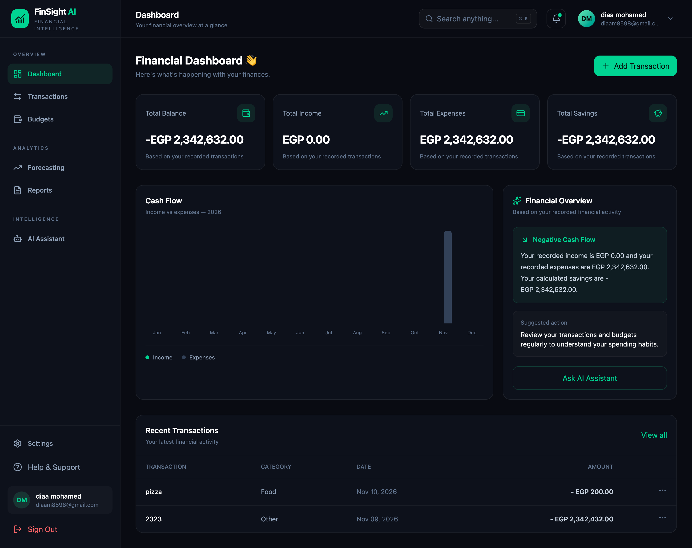

# 💰 FinSight AI
### Smart Personal Finance Management Powered by Artificial Intelligence

FinSight AI is a modern personal finance management application designed to help users track income and expenses, manage budgets, analyze financial performance, and explore AI-powered financial insights.

Built with **React, Python, FastAPI, SQLAlchemy, and Groq AI**.

<p align="center">
  
</p>

## 📸 Application Screenshots

### Dashboard
<p align="center">
  
</p>

### Transactions & Budgets
<p align="center">
  
  
</p>

### Financial Reports & Forecasting
<p align="center">
  
  
</p>

### AI Financial Assistant
<p align="center">
  
</p>

*Add your actual application screenshots to `docs/images/` using the filenames above.*

---

## ✨ Main Features

- **Financial Dashboard:** View income, expenses, balance, and financial activity.
- **Transaction Management:** Create, edit, delete, and organize transactions.
- **Budget Management:** Set spending limits and monitor category budgets.
- **Financial Reports:** Analyze expenses and income through visual reports.
- **Financial Forecasting:** Explore projected financial performance.
- **AI Assistant:** Ask questions and receive AI-generated financial guidance using Groq.
- **Authentication:** Secure registration and login using JWT.
- **Settings:** Manage profile, currency, and notification preferences.

## 🛠️ Tech Stack

| Frontend | Backend | AI & Data |
|---|---|---|
| React | Python | Groq API |
| Vite | FastAPI | SQLAlchemy |
| Tailwind CSS | Uvicorn | SQLite |
| React Router | Pydantic | JWT |
| Axios | REST API | Recharts |
| Lucide React | Python-JOSE | |

## 🏗️ Project Structure

```text
FinSight-AI/
│
├── backend/
│   ├── app/
│   │   ├── main.py
│   │   ├── database.py
│   │   ├── models.py
│   │   ├── schemas.py
│   │   └── ...
│   ├── requirements.txt
│   └── .env.example
│
├── frontend/
│   ├── public/
│   ├── src/
│   │   ├── components/
│   │   ├── pages/
│   │   ├── services/
│   │   ├── App.jsx
│   │   ├── main.jsx
│   │   └── index.css
│   ├── package.json
│   └── .env.example
│
├── docs/
│   └── images/
│
└── README.md
```

## 🚀 Installation & Setup

### 1. Clone the Repository

```bash
git clone https://github.com/diaamohamed26/FinSight-AI_python_react.git

cd FinSight-AI_python_react
```

### 2. Backend Setup

```bash
cd backend

python3 -m venv venv

source venv/bin/activate

pip install -r requirements.txt
```

Create a `.env` file inside `backend/`:

```env
GROQ_API_KEY=your_groq_api_key
GROQ_MODEL=openai/gpt-oss-120b
```

Start the backend:

```bash
python -m uvicorn app.main:app --reload
```

Backend URL:

`http://127.0.0.1:8000`

API documentation:

`http://127.0.0.1:8000/docs`

### 3. Frontend Setup

Open another terminal:

```bash
cd frontend

npm install
```

Create a `.env` file inside `frontend/`:

```env
VITE_API_URL=http://127.0.0.1:8000/api
```

Start the frontend:

```bash
npm run dev
```

Open:

`http://localhost:5173`

## 🔌 API Modules

| Module | Endpoint |
|---|---|
| Authentication | `/api/auth/register` |
| Login | `/api/auth/login` |
| Current User | `/api/auth/me` |
| Dashboard | `/api/dashboard` |
| Transactions | `/api/transactions` |
| Budgets | `/api/budgets` |
| Reports | `/api/reports/expenses` |
| Forecasting | `/api/forecast` |
| AI Assistant | `/api/ai/chat` |
| Settings | `/api/settings` |

*Endpoint availability depends on the implemented backend routes.*

## 🤖 AI Capabilities

The AI assistant is designed to support:

- Monthly expense analysis.
- Savings recommendations.
- Cash-flow explanations.
- Budget planning assistance.
- Personalized financial insights.

AI responses depend on the configured Groq API integration and available financial data.

## 🔐 Security

- JWT-based authentication.
- Protected API endpoints.
- Environment variables for sensitive credentials.
- Private API keys excluded from frontend code.
- Database and virtual environment files excluded from Git.

## 🔮 Future Enhancements

- Advanced financial analytics.
- AI-powered personalized recommendations.
- Recurring transactions.
- Savings goals.
- PDF and Excel report exports.
- Improved forecasting models.
- Interactive financial insights.

## 👨‍💻 Developer

**Diaa Mohamed Abdelazize**

Software Engineer | Full-Stack Developer | AI Enthusiast

- GitHub: [@diaamohamed26](https://github.com/diaamohamed26)
- LinkedIn: [Diaa Mohamed](https://linkedin.com/in/diaa-mohamed-a50460125)

## 📄 License

Created for educational, development, and portfolio purposes.
